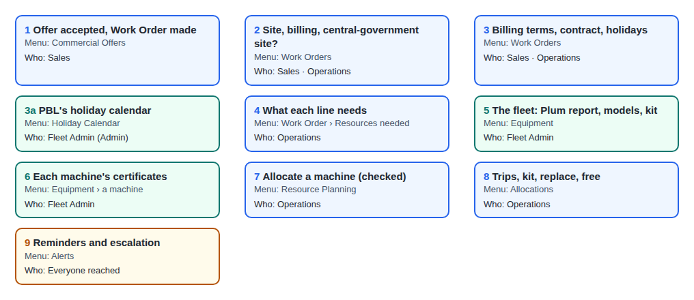
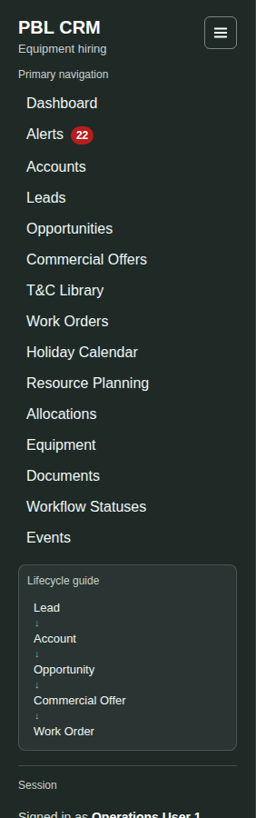
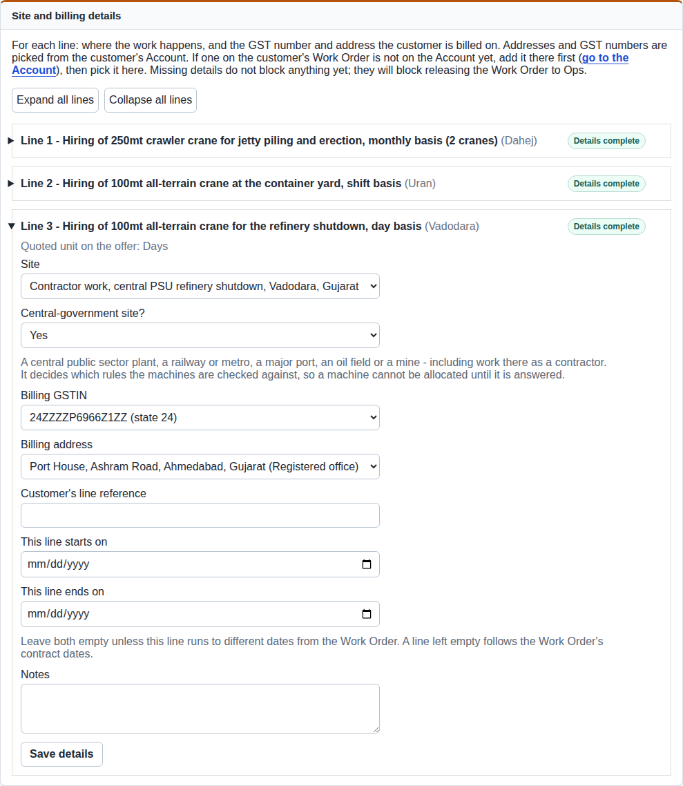
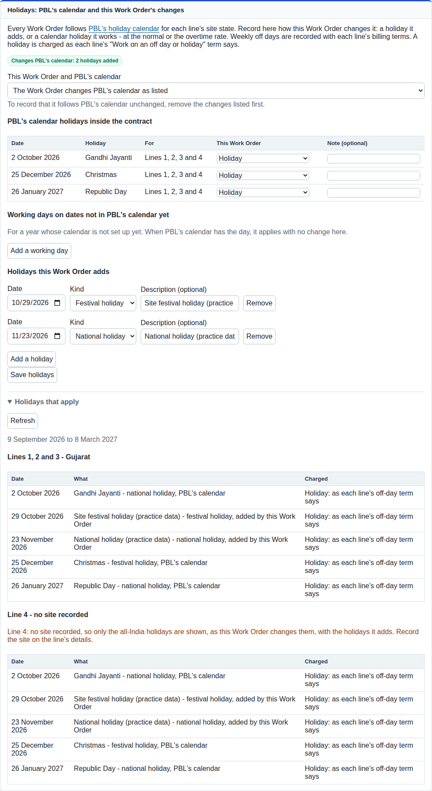
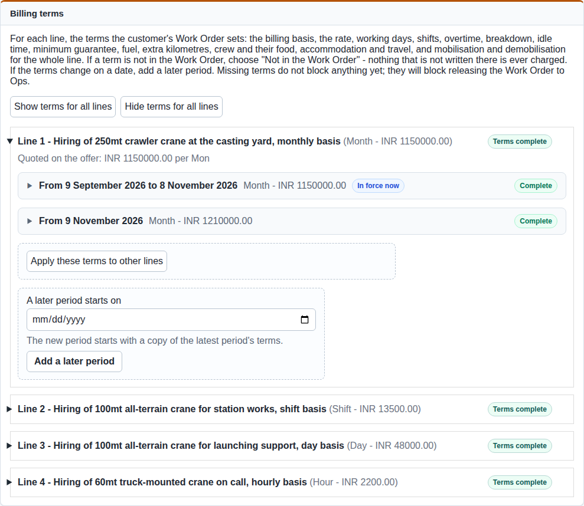
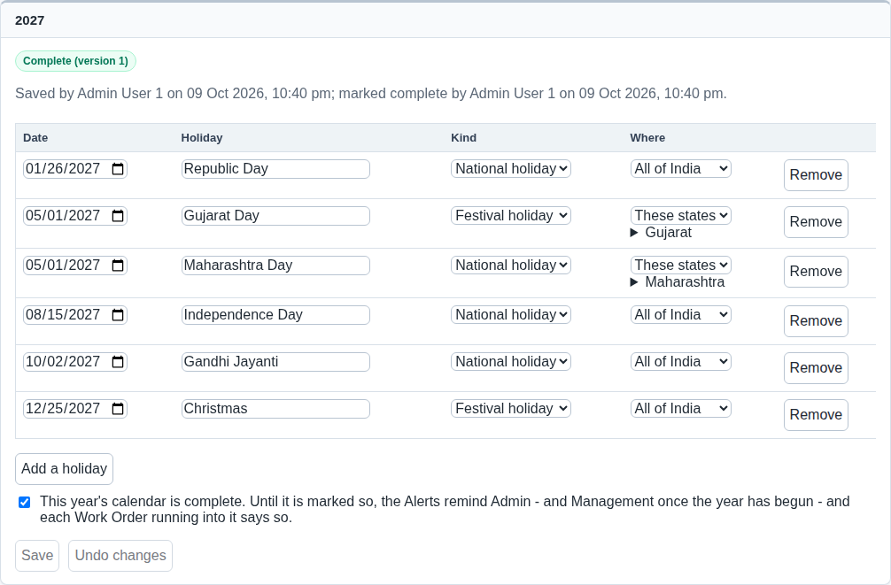
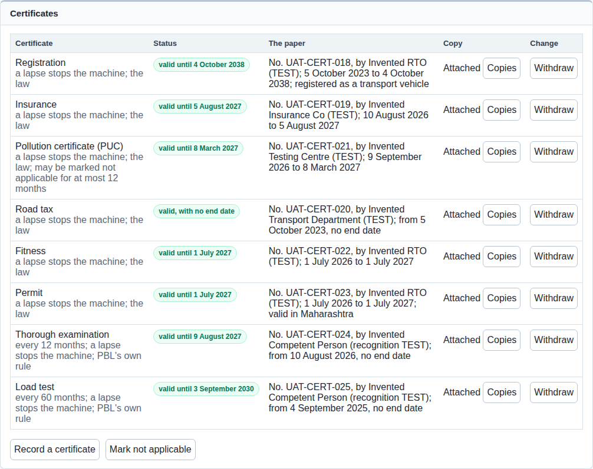
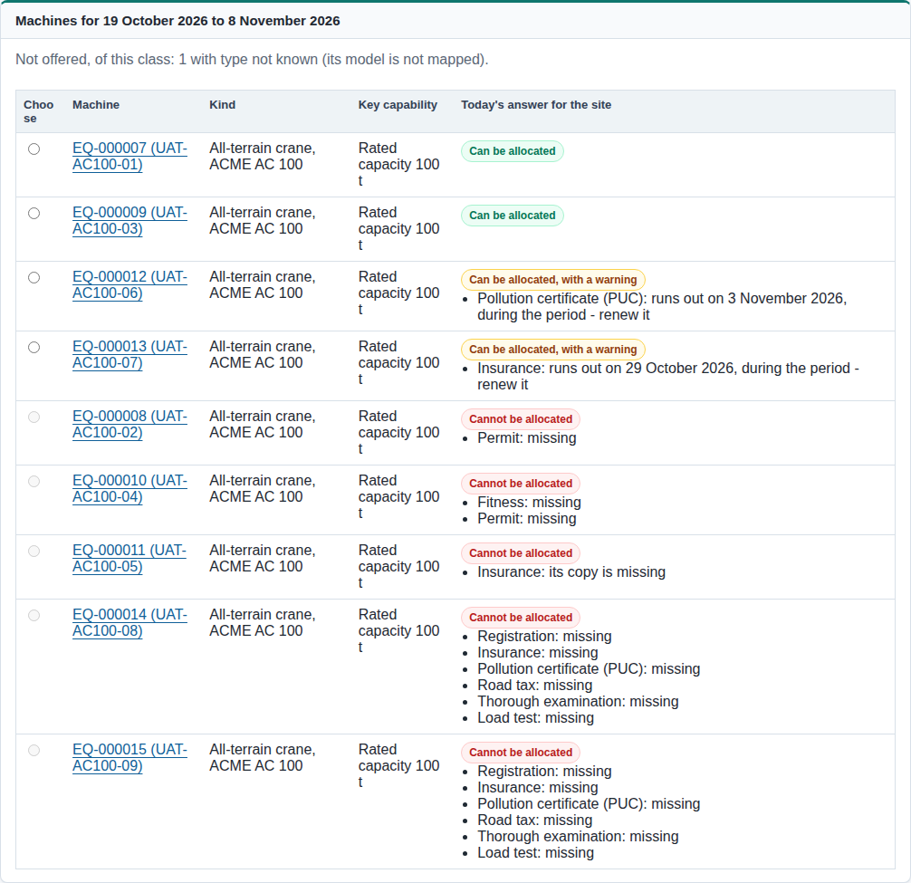
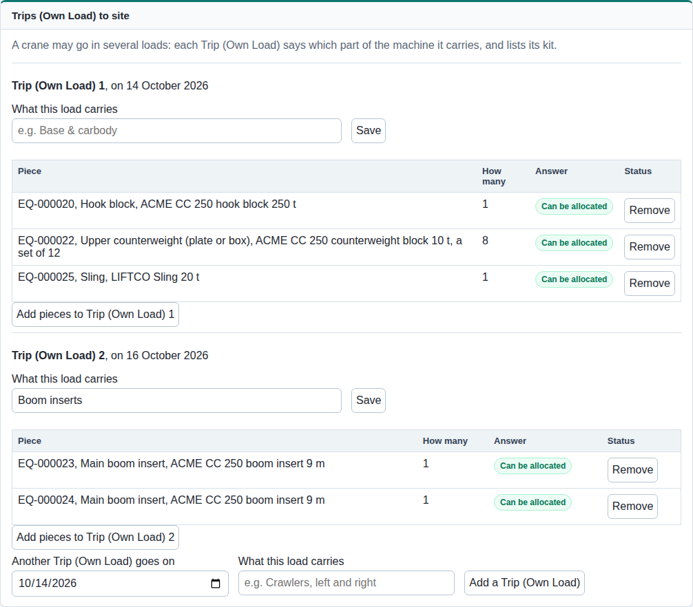
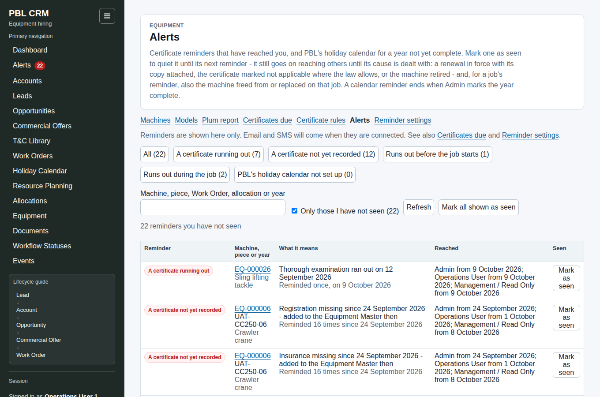

# PBL Hiring - User Guide

For the Hiring user test, on **the Hiring test site**. It follows one job from an accepted offer
to a machine allocated, and the reminders that follow it: which menu item to open, where the button is, and who may
press it. Read it before your sheet; come back to it whenever something seems missing.

You sign in twice: first the **site login** (a browser box), then **your own username and password**.

**What is already there.** The site starts with **PBL's machines** - invented, every machine number beginning `UAT-`,
brought in from an invented Plum report with their papers and kit - and **PBL's holiday calendar** for this year and
next. Every customer, offer and Work Order is made by a tester: the Sales tester's begin `T1-`. Dates in the machines'
papers count from the day they were loaded ("day 0"): "runs out in 5 days" means 5 days after that day.

**The pictures** in this guide were taken on the first round's practice data, so the names in them (`UAT-H ...`,
`WO-000001`) are not the ones you will see, and their date boxes show the month first; yours show dates in your own
browser's order. The screens are the same.

---

## 1. The flow at a glance

| # | Step | Menu, then | Who does it |
| --- | --- | --- | --- |
| 1 | The customer accepts the offer; the Work Order is made | **Commercial Offers** > the offer | Sales (Operations may also make the Work Order) |
| - | PBL's holiday calendar, kept each year | **Holiday Calendar** | Fleet Admin (Admin); everyone reads |
| 2 | Each line's site, billing GSTIN and address; "Central-government site?" | **Work Orders** > the Work Order > *Site and billing details* | Sales, Operations |
| 3 | Billing terms, contract period, holidays | the same Work Order page | Sales, Operations; Accounts reads |
| 4 | What each line needs on site: a **resource requirement** | the Work Order > *Resources needed* > **Add a requirement** | Operations |
| 5 | PBL's fleet: Plum's report, models, kit | **Equipment** | Fleet Admin |
| 6 | Each machine's certificates | **Equipment** > a machine > *Certificates* | Fleet Admin |
| 7 | Allocate a machine; eligibility is checked for the site and days | **Resource Planning** > the requirement > **Allocate a machine** | Operations |
| 8 | Trips (Own Load) and kit; replace or free a machine | **Allocations** > the allocation | Operations |
| 9 | Reminders, and who they reach | **Alerts**; **Equipment** > *Reminder settings* | Everyone they reach; Admin sets them |

"Fleet Admin" is the **Admin** login until that role exists.

## 2. The menu

Every menu item shows to everyone. **What changes with your role is the buttons inside a page**: a role that may not
act sees the same page without the button (sometimes with a line saying who may).

| Menu item | What it is for in Hiring |
| --- | --- |
| **Alerts** (red count) | The certificate reminders that have reached you. The count is those you have not marked seen |
| **Commercial Offers** | Where an offer is accepted and its Work Order made |
| **Work Orders** | Every Work Order; open one for its lines, terms, holidays, requirements and allocations |
| **Holiday Calendar** | PBL's holidays, year by year, for all of India or for named states. Every Work Order follows it |
| **Resource Planning** | Every resource requirement, urgent first; open one to allocate |
| **Allocations** | Every machine allocated; "Starting in the next 15 days" |
| **Equipment** | The fleet, with its own row of links: Machines · Models · Plum report · Certificates due · Certificate rules · Alerts · Reminder settings |

---

## 3. Step by step

### Step 1 - Offer accepted, Work Order made

**Where:** Commercial Offers > the offer.

1. **Submission** tab > card *Customer Response / Award Outcome* > *Record new customer response*. **Outcome starts at
   "Pending customer decision" - change it to "Accepted / awarded"**, fill *Response received at*, press **Record
   customer response**. *Who:* Admin, Sales User, Sales Manager. Others read the history.
2. **Create Work Order** now appears **at the top of the offer, in its row of buttons after Refresh and Edit Commercial
   Offer / Status** (to the right of the offer's name on a wide screen, under its badges on a narrower one) - *not*
   beside the status you just recorded on the Submission tab. *Who:* Admin, Sales User, Sales Manager **and Operations
   User**. Accounts and Management do not see it.

3. On *Create a Work Order*, enter the **Customer WO reference** - the customer's order number, or the Letter of
   Intent's; it is required - and, if you have them, the *Received date* and *Remarks*. Every accepted line is ticked, with a quantity box holding all of it. Press **Create Work
   Order**; a green panel *Work Order created* gives **Open WO-…**. If the customer awarded the work in parts, untick a
   line or lower its quantity: a later Work Order takes only what is not on one yet, and each line shows what is
   already on a Work Order and what is left. One customer order makes one Work Order: a reference already used on
   this offer is refused beside the button, naming its Work Order, so pressing Create again, or the same order in a
   second tab, makes no second Work Order. Asking for more than is left is refused too. *(Since 8 October 2026,
   CS-04.)*

**Once every line is on a Work Order in full, the top of the offer no longer shows it** (while anything is left, it
shows **Create another Work Order**). Open the Work Order from the offer's **Submission** tab
(*Lifecycle Guidance* > **Open Work Order**), its **Traceability** tab, or the **Work Orders** menu.

### Step 2 - Each line's site and billing

**Where:** Work Orders > the Work Order > group **Lines** > card **Site and billing details**: each line folds open
on its own (**Expand all lines** at the top). Fields: Site, **Central-government site?**, Billing GSTIN, Billing address,
Customer's line reference, the line's own dates; **Save details** at the foot of each line.

*Who:* Admin, Sales User, Sales Manager, Operations User. Accounts and Management see the same facts, read only.

The site and the central-government answer matter for allocation: **a line with no site, or no answer, cannot be
allocated**. Why they matter: section 4.4 and 4.5.

### Step 3 - Billing terms, contract period, holidays

All on the Work Order page; the same four roles edit them (Admin, Sales User, Sales Manager, Operations User); Accounts
and Management read.

- **Billing terms** (group *Lines*): each line folds open on its own; each period inside it has three chapters - *The
  rate*, *Working time*, *Extra charges*.
  **Start billing terms**, then **Save terms**. **Add a later period** for a new rate from a date. **Apply these terms to other lines** copies them. The card says when a line's terms are complete.
- **Contract period** (group *The Work Order*): start, and end on a date or "until the work is complete";
  **Save contract dates**. An extension is recorded below it (**Record extension**).
- **Holidays: PBL's calendar and this Work Order's changes** (group *The Work Order*). Every Work Order follows PBL's
  holiday calendar (Step 3a) for each line's site state. Answer **The Work Order follows PBL's calendar unchanged**, or
  **The Work Order changes PBL's calendar as listed** and list the changes: a calendar holiday the job works through -
  **Working day, normal rate** or **Working day, overtime rate** - or a holiday the Work Order adds (**Add a holiday**).
  A working day on a date the calendar does not have yet goes under **Add a working day**. **Save holidays**.
  **Holidays that apply**, below, shows the result for the contract period, grouped by state - "Line 1 - Gujarat",
  "Line 2 - Maharashtra" - each day saying where it came from and how it is charged. Weekly offs are part of each
  line's billing terms, not of this list. *(PBL decision, 2 October 2026; built 3 October 2026, HOL-1.)*

- **The shifts and the crew's upkeep** (Slice 7D Part 5). In *Working time*, card **Shifts**: *Shifts a day* - not in
  the Work Order, one, two or three - and each shift's hours (together no more than 24); for two or three, whether
  **the same rate covers every shift** or **each later shift has its own rate** (per shift, per hour, or a % of the
  first shift's rate, the Work Order rate). With overtime on two or three shifts, **Overtime** also asks whether it is
  counted per shift or for the whole day. In *Extra charges*, once the Work Order states its crew, card **Crew food,
  accommodation and travel** asks, for operators and helpers separately, about food, accommodation, travel to and from
  the job, and daily travel to site: not in the Work Order, provided by the customer, or provided at a cost - the cost,
  what it is per, and whether it is **deducted from PBL's invoice** or **billed to PBL separately** by the customer.
  **Same as for operators** copies the operators' answers to the helpers. A line's terms are complete only with these
  answered. Nothing is calculated from them yet: billing will read them.

### Step 3a - PBL's holiday calendar

**Where:** **Holiday Calendar**. One calendar a year, January to December; each holiday has its date, its kind
(national or festival), its name and where it applies - **All of India**, or **These states**. Pick a year at the top:
"Not set up", "Being entered (version N)" or "Complete (version N)".

*Who:* **Admin** adds and removes holidays, ticks **This year's calendar is complete**, and presses **Save**; a change
to a day already passed is warned about beside the button. Everyone else reads it.

Every Work Order uses the calendar as it is now, for each line's site state. Until a year is marked complete, the
Alerts remind Admin - and Management once the year has begun - and each Work Order running into it says so.

### Step 4 - What each line needs: the resource requirement

**Where:** the Work Order > group **Resources needed** > **Add a requirement**, at the right of each line's heading. The
form asks the kind of machine (class, type), its capacity, how many, from and to, crew; **Save requirement**.

*Who:* **Admin and Operations User only.** Sales, Accounts and Management see the requirements, no button.

Every requirement is also listed under **Resource Planning**, urgent first.

### Step 5 - The fleet (Fleet Admin)

**Where:** Equipment.

- **Plum report**: upload Plum's *Own Vehicle Complete Information Report* (**Upload and preview**), then on the
  preview map new model names, pair a crane with its carrier, read odd values, and **Confirm**. A confirmed report is
  the whole fleet: a machine missing from it is flagged. *Who:* Admin only - others read "Only Admin uploads and
  confirms Plum's report."
- **Models**: **Record a model**, **Change**, **Map a Plum model name**. A machine whose Plum name is not mapped has no
  known type (UAT-XC60-01). *Who:* Admin; others read.
- **Machines** > a machine: its facts, fitted parts (a crane's carrier), and for a crane model that takes kit,
  **Add kit** (hook blocks, counterweights, boom inserts, slings). *Who:* Admin; others read. Engine and chassis
  numbers show to Admin only.

### Step 6 - Each machine's certificates (Fleet Admin)

**Where:** Equipment > Machines > the machine > card **Certificates**. At its foot: **Record a certificate** (with its
copy - a certificate counts only once its copy is attached), **Mark not applicable** where the law allows. **Withdraw**
corrects a mistake. Below: **Check for a site** - choose a state and dates, press **Check**, and see what allocation
would say (everyone may check).

*Who:* Admin records, marks, withdraws and attaches copies, and sees certificate numbers and copies. Others see each
certificate's kind, issuer, dates and status.

**Certificates due** (Equipment) lists every machine's papers running out, run out or missing - the renewal list.

### Step 7 - Allocate a machine

**Where:** Resource Planning > the requirement > card *Machines - x of y units covered* > **Allocate a machine to unit
N**. (Or from the Work Order: the requirement's reference under *Resources needed*.)

On the allocate page: **Find machines for these days**, then a table of every machine of the kind asked for, each
with its answer for **this site and these days**:

- **Can be allocated** - choose it, **Allocate**.
- **Can be allocated, with a warning** - e.g. a certificate runs out during the job. Tick **I have seen these warnings**, then
  **Allocate, with these warnings**. The warning stays on the allocation.
- **Cannot be allocated** - nobody can override it; the reasons are listed.

*Who:* **Admin and Operations User.** Others see the machines and answers but cannot choose: "Your role can see the
machines. Operations and Admin allocate them."

### Step 8 - The allocation: trips, kit, replace, free

**Where:** Allocations > the allocation (or from the Work Order's *Machines allocated*).

- **Eligibility**: the answer stored when allocated, and *today's* answer; **Check again** stores a new one.
- **Billing cycle**: how often this machine is invoiced. *Who:* Admin, Sales User, Sales Manager, Operations User.
- **Trips (Own Load) to site**: a crane may go in several loads. **Add pieces to Trip (Own Load) N** lists kit on a trip (each
  piece is checked like the crane); **Add a Trip (Own Load)**.
- **Change the dates** (once an allocation has started, only its last day can change); **Replace the machine** (the old allocation stays on the history); **Free the machine**
  (with a reason; **Yes, free it**).

*Who:* Admin and Operations User. Others read: "Your role can view this allocation. Operations and Admin change it."

### Step 9 - Reminders and who they reach

**Alerts** shows the certificate reminders that have reached **you**. **Mark as seen** quiets one for you until its
next reminder day; it never stops the reminders, nor their reaching others - only dealing with the cause does:

- a **certificate's** reminders ("running out", "not yet recorded") stop when it is renewed with its copy, or marked
  not applicable where the law allows, or the machine is retired;
- a **job's** reminders ("before the job starts", "during the job") also stop when the machine is freed from that job
  or replaced on it - but the certificate's own reminders carry on until the certificate is dealt with.

The row stays, "Seen by you", until the list is read again (**Refresh**). Above the list: how many it holds of all your
reminders not seen.

| Reminder | Raised for | Who it reaches (standard) |
| --- | --- | --- |
| **A certificate running out** | every machine and piece of kit | Admin from the first reminder (60 days before); Operations from 15 days before; Management from 7 days before |
| **A certificate not yet recorded** | papers never entered since the machine was added, a rule began, or a registration said transport | Admin at once; Operations 7 days after; Management 14 days after |
| **Runs out before the job starts** | an allocated machine or its kit | Admin and Operations at once; Management from 7 days before |
| **Runs out during the job** | the same | the same |
| **PBL's holiday calendar not set up** | a year not marked complete | Admin from 60 days before 1 January; Management from 1 January |

Reminders repeat 60 and 30 days before, weekly from 15, daily from 7, and every day once run out. **Sales and
Accounts are on no path**: their Alerts page is empty - that is the agreed design, not a fault. **Reminder settings**
(Equipment) shows each schedule and path; Admin changes them, and a change applies at once.

---

## 4. Why the rules are what they are

These rules stop a machine going to a job with papers the law or PBL requires missing. The practice data has a
machine for each. Where the law is unclear, the system takes the cautious reading.

### 4.1 Which papers a machine needs

| Paper | Needed by | Interval | Whose rule |
| --- | --- | --- | --- |
| Registration, insurance, PUC, road tax | every crane, man lift, forklift, excavator | as the paper says | the law (Motor Vehicles Act) |
| Fitness and permit | **transport vehicles only** (4.3) | as the paper says | the law |
| Thorough examination | cranes, man lifts, forklifts, hook blocks, tackle | **12 months**; slings **6 months** | **PBL's rule** - the law currently sets none |
| Load test | the same | **5 years** | PBL's rule |

An examination counts for its interval from the day it was done, whatever the report prints.

### 4.2 Crawler or wheeled: "not applicable"

A **crawler or derrick crane** cannot travel on public roads on its own power, so it is very likely not a motor
vehicle: its road papers may be marked **not applicable**, with the reason. A **wheeled crane** on its own power *is*
a motor vehicle - the law is clear - so its road papers can never be marked (the option is not offered).
*Examples:* UAT-CC250-01 (crawler, road papers marked, can be allocated); any UAT-AC100 crane (wheeled, no mark).

One exception: a wheeled crane's **PUC is needed only from one year after registration**, so a first-year PUC may be
marked for at most 12 months. *Example:* UAT-AC100-06 - marked until day 25, so a job running past it gets a warning.

### 4.3 Transport registration: fitness and permit

Most cranes are registered **non-transport** (construction equipment) and need neither fitness nor a permit. A crane
registered **transport** needs both, and its **permit must cover the site's state, or all of India**. A machine with
**no registration recorded is treated as not a transport vehicle**: its missing registration already stops it; fitness
and permit are asked for once a transport registration is entered (owner's decision, 1 October 2026).

| Machine | Registration | Fitness / permit | At a Gujarat site |
| --- | --- | --- | --- |
| UAT-AC100-01 | non-transport (on its carrier, UAT-AC100-01C) | not needed | can be allocated |
| UAT-AC100-02 | transport | permit for **Maharashtra only** | **cannot** - but can at a site in Maharashtra |
| UAT-AC100-03 | transport | permit for **all India** | can be allocated |
| UAT-AC100-04 | transport | **none recorded** | cannot |
| UAT-CC250-05 | transport, **and** "not applicable" marked | none | cannot: a registration in force wins over its mark |

### 4.4 Why a site's state is asked

The site's state decides which rules apply. **Today it changes the answer through the permit** (4.3). It is built
for more: rules can be held **by state**, and the check takes a state's own rule before the all-India one. That
matters because the states have moved differently since the new labour codes (November 2025):

- **Gujarat** has final rules, which set **no** examination interval for cranes and tackle (and a draft would let it
  demand re-certification of another state's certificates).
- **Maharashtra** has drafts only, so its old rules continue - examination every 12 months, load test every 5 years.
- Most other states are like Maharashtra.

PBL's own 12-month and 5-year rule applies everywhere, so the answer is the same in every state today. When a state
issues its own rule, **Admin adds it on Certificate rules** (Equipment) - no change to the system. No state rule is
loaded yet: none is law that PBL has adopted. The Fleet Admin's sheet adds a test rule to show the effect, then ends it.

### 4.5 Why "Central-government site?"

Sites of the central government - a central PSU plant, a railway or metro, a major port, an oil field or mine,
**including work there as a contractor** - have the **central government**, not the state, as their safety
authority. So at such a site the **examinations follow the central-government rules**, while road papers and permits
still follow the site's state. Today no central-government rule has been issued, so the check falls back to PBL's
all-India rule; the answer is recorded so that it applies the day one is. **Unanswered, the line cannot be allocated.**
*Examples:* **Yes** - contract work at a central PSU refinery, at a major port, on a metro line. **No** - Dahej (not a
major port), a private container freight station, a private refinery or pipeline terminal.

### 4.6 Copies, renewals and when a certificate counts

A certificate counts only **with its copy attached**, not withdrawn, and in date. *Example:* UAT-AC100-05 - insurance
recorded without its copy: cannot be allocated. A renewal recorded ahead takes over on its start date - but only if
it has its copy. *Example:* UAT-AC100-07 - insurance ends day 20, the renewal from day 21 has no copy, so the cover
still ends on day 20: a warning for a job running past it.

### 4.7 Kit is checked on its own

Each piece of kit on a trip is checked like the crane. *Example:* two hook blocks and two 20 t slings; one of each
was examined 7 months ago. That hook block is fine (12 months); that sling **cannot go** (6 months).

### 4.8 The three answers

| Answer | What happens |
| --- | --- |
| **Can be allocated** | allocate |
| **With a warning** (a paper runs out before or during the job, or within 15 days) | allocate after ticking "I have seen these warnings"; the warning stays |
| **Cannot be allocated** (missing, copy missing, run out) | refused; nobody can override |

"Needs approval" exists for a future PBL rule that may be overridden; no rule loaded today uses it.

---

## 5. Who can do what

Everyone can **read** every page below. ✓ = can do it; - = sees the page, not the button.

| Action | Admin | Sales User | Sales Manager | Operations | Accounts (Finance) | Management |
| --- | --- | --- | --- | --- | --- | --- |
| Accept an offer (customer response) | ✓ | ✓ | ✓ | - | - | - |
| Create the Work Order | ✓ | ✓ | ✓ | ✓ | - | - |
| Site and billing, billing terms, contract period, a Work Order's holidays | ✓ | ✓ | ✓ | ✓ | - | - |
| PBL's holiday calendar | ✓ | - | - | - | - | - |
| Add or change a resource requirement | ✓ | - | - | ✓ | - | - |
| Allocate, replace, free, change dates, trips and kit | ✓ | - | - | ✓ | - | - |
| An allocation's billing cycle | ✓ | ✓ | ✓ | ✓ | - | - |
| Plum report, models, machines, kit, certificates | ✓ | - | - | - | - | - |
| See certificate numbers and copies | ✓ | - | - | - | - | - |
| Certificate rules, Reminder settings | ✓ | - | - | - | - | - |
| Check a machine for a site | ✓ | ✓ | ✓ | ✓ | ✓ | ✓ |
| Mark a reminder seen | ✓ | (none reach them) | (none reach them) | ✓ | (none reach them) | ✓ |
| Business events (history) | ✓ | - | - | - | - | ✓ |

## 6. Not built yet

Release of the Work Order to Operations, Customer Master approval, hired (vendor) machines, crew, gate passes and
dispatch, log sheets, billing and invoices. Reminders are on screen only - no email or SMS. Positions and regions in
the reminder paths come later; they name roles today.
